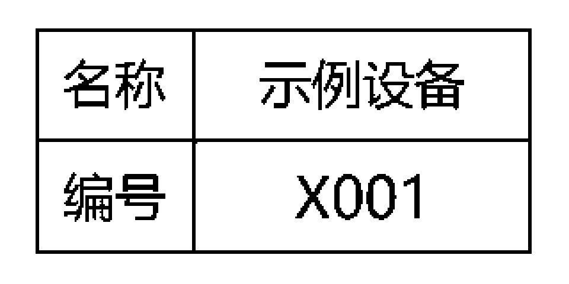

# 精臣 B21 蓝牙打印

不用在 App 里一张一张改编号。填好模板和编号范围，直接从电脑通过蓝牙批量打印。

一个小型、非官方、本地运行的 **NIIMBOT 精臣 B21-C2B** 标签工具。最初用来打印「名称 / 编号」两行两列的设备标签：计算服务器，X001～X028。

- **直接蓝牙打印**：无需精臣云打印 App，不依赖 Windows 打印机驱动。
- **先看再打**：预览和默认 dry-run 完全离线，不连接打印机。
- **批量编号**：自定义名称、前缀、起止编号与补零位数。
- **出错就停**：每张完成后重连，检查型号、纸卷商品条码、盖子与纸张状态；不自动重试不确定的任务。
- **不上传标签**：工具无云端接口、遥测或后台服务；本地任务记录不保存设备地址、RFID 序列号或原始数据包。



## 支持范围，先看这里

| 项目 | 当前状态 |
| --- | --- |
| 实机验证 | Windows 电脑 + B21-C2B（型号 ID 775）+ 40 × 20 mm 间隙标签，连续 28 张完成 |
| 同配置系列 | 代码允许 ID 771 / 775；771 尚未单独实测 |
| 打印头 | 203 dpi 级别，384 点；标签栅格 320 × 160 点 |
| 其他 B21 / B21 Pro / 其他纸张尺寸 | **不保证支持，程序会拒绝不匹配配置** |
| macOS / Linux | 预览/编码可移植，但蓝牙实机未验证，不宣称可用 |
| 中文字体 | 默认使用 Windows 已安装的微软雅黑；其他环境需指定本机中文字体 |

**先试一张，确认纸张尺寸与出纸方向。** 商品条码用于检查换卷，不是自动测量尺寸；必须人工对照纸卷包装确认 40 × 20 mm。重复执行会再次出纸，没有全局自动去重。

## 安装

需要 **Python 3.11+**、可用的蓝牙适配器。以下为 Windows PowerShell 示例：

```powershell
git clone https://github.com/HosisoraLing/niimbot-b21-print.git
cd niimbot-b21-print
py -3 -m venv .venv
.\.venv\Scripts\python.exe -m pip install --upgrade pip
.\.venv\Scripts\python.exe -m pip install .
```

仅依赖 [Pillow](https://python-pillow.org/) 与 [Bleak](https://github.com/hbldh/bleak)；没有打包它们、厂商 SDK、固件或字体。安装依赖需联网；配置好后预览与打印无需互联网。

## 三分钟上手

### 1. 建配置、扫设备

打开打印机，关闭手机精臣 App 的连接，保持打印机在电脑附近。

```powershell
.\.venv\Scripts\b21-print.exe init
.\.venv\Scripts\b21-print.exe scan
```

`init` 创建本地 `config.json`，若已存在会拒绝覆盖。扫描只显示 B21 设备，在本地把选定设备的 `address` 填进配置；不自动连接第一个设备。

> 扫描显示的名称可能含设备序列号，地址和本地配置不要公开上传。默认 `.gitignore` 已忽略 `config.json`、输出和日志；仍请自行检查截图和 issue 内容。

### 2. 核实纸卷，预览标签

```powershell
.\.venv\Scripts\b21-print.exe inspect
```

这一步只握手和查询，不打印、不走纸，但机器可能响一下连接提示音。输出型号、就绪状态和 **纸卷商品条码**，不输出纸卷序列号。把商品条码填入 `expected_barcode`，并对照纸卷包装人工确认尺寸为 40 × 20 mm。不要把打印机名称中的编号当成纸卷条码。

编辑配置中的 `name`、`prefix`、`start`、`end`，然后生成图片：

```powershell
.\.venv\Scripts\b21-print.exe preview
```

查看输出目录中的 `preview.png` 与逐张黑白 PNG；编号前缀不会用于文件名，避免特殊字符导致错误路径。原始模板默认使用常规字体、2 点边框、左右 2.5 mm / 上下 2 mm 留白；密集中文字一味加粗可能发糊，不建议先改大改粗再整批打印。

### 3. 先一张，再整批

默认命令只是离线检查，不连接蓝牙：

```powershell
.\.venv\Scripts\b21-print.exe print --start 1 --end 1
```

真正试印一张（两个开关缺一不可）：

```powershell
.\.venv\Scripts\b21-print.exe print --start 1 --end 1 --execute --confirm-paper-size
```

实物满意后打印剩余 X002～X028：

```powershell
.\.venv\Scripts\b21-print.exe print --start 2 --end 28 --execute --confirm-paper-size
```

需要重新完整打印时，显式指定 `--start 1 --end 28`。每张会单独连接，连接提示音可能重复响；这是实机验证的固件兼容处理，并非高速连续打印方案。可以 Ctrl+C 停止，但正在出纸的一张未必能瞬时停止。

## 配置项

可从 [示例配置](config.example.json) 复制。未知字段、错误类型或越界值会被拒绝。

| 字段 | 用途 |
| --- | --- |
| `address` | `scan` 返回的所选设备地址；必需本地填写 |
| `expected_barcode` | `inspect` 返回、且与包装规格核对后的纸卷商品条码 |
| `name` / `prefix` | 名称和编号前缀，默认计算服务器 / X |
| `start` / `end` / `digits` | 编号范围及补零位数；每批最多 500 张，数字 1..999999 |
| `width_mm` / `height_mm` | 当前固定 40 / 20，不会把未测试尺寸直接送给打印机 |
| `density` | 黑度 1..5，默认 3 |
| `font_path` | 默认空；Windows 自动使用已安装的微软雅黑。也可指定合法持有的中文 TTF/OTF/TTC 字体路径 |
| `font_size` / `number_font_size` | 目标字体点数（栅格像素），默认 29 / 32；太宽会缩小适配 |
| `margin_x_mm` / `margin_y_mm` | 标签外边距，默认 2.5 / 2 |
| `line_dots` / `cell_padding_dots` | 边框厚度 / 单侧单元格留白（点），默认 2 / 6 |

字体文件由用户自行安装并遵守对应许可，本仓库不包含字体。如果用自定义输出目录，仍须避免把生成标签和任务记录提交到 Git。

## 失败或中断后怎么补打

任务保存在本地输出目录 `jobs/`：

- `confirmed_numbers`：已收到打印与出纸 100%、并完成结束确认的编号。
- `current_number`：当前尝试的编号；中断时即使尚未记录完成，也可能已经出纸。
- `failed_or_uncertain`：**不代表整批没打**。必须先看实物，再结合记录补打缺少范围。
- 不自动重试、自动重打或自动续传，避免因 ACK 丢失造成重复。

盖子打开、缺纸、换卷条码不符、型号/状态未知、BLE 写入长度不足、通信超时、打印机错误等都会停止。任务只保留必要的内容/编号和结果，不存蓝牙身份与原始 RFID；它仍包含标签名称等业务信息，不应公开分享。

## 开发与测试

```powershell
.\.venv\Scripts\python.exe -m pip install -e .
.\.venv\Scripts\python.exe -m unittest discover -s tests -v
```

测试只用模拟 BLE，不操作真实打印机。覆盖配置、编码 XOR 校验/拆包、标签栅格、逐张重连、纸卷与型号保护、错误取消、不自动重试、dry-run 安全边界。CI 在 Windows / Linux 上运行离线测试，不进行硬件测试。

开发时可用 `python -m b21_print`，与 `b21-print` 命令等效。源码位于 `src/b21_print`。

## 许可证与来源

**AGPL-3.0-only**。原创代码 Copyright (C) 2026 HosisoraLing and contributors。使用、修改与分发须遵守完整 [AGPLv3](LICENSE)；修改版通过网络向用户提供服务时，须按许可证第 13 条提供对应源码的获取机会。本 CLI 本身没有网络服务。

打印协议与流程参考了 [NiimBlueLib](https://github.com/MultiMote/niimbluelib) 和 [niimprint](https://github.com/AndBondStyle/niimprint)，保留其 MIT 版权与许可；详见 [第三方声明](THIRD_PARTY_NOTICES.md)。上游 README 的用途警告也在该文件中如实记录，不给本项目 AGPL 额外添加“仅非商业”限制，也不替使用者保证所有厂商/第三方权利已获授权。

本项目与 NIIMBOT 无隶属、赞助或认可关系；品牌型号仅用于兼容性说明。**无任何担保**，输出效果以实物为准。报告问题前请先删除地址、序列号、配置、标签内容等敏感信息；不要上传厂商固件或私有数据包。
